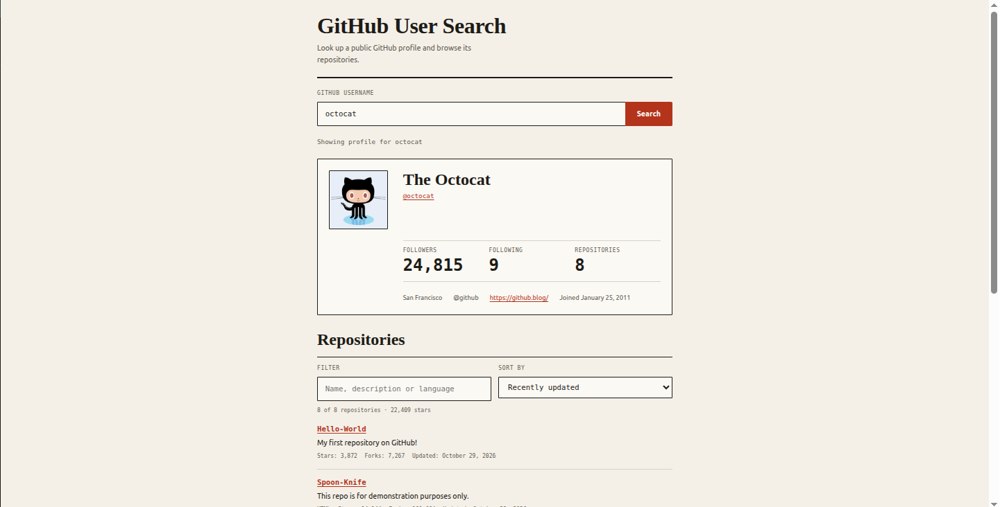
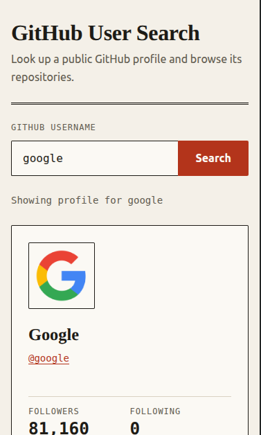
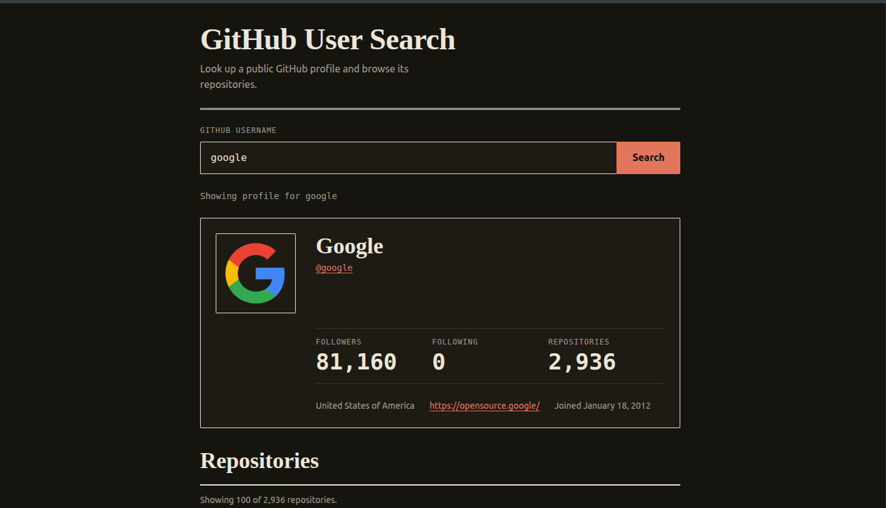

# GitHub User Search

Search a GitHub user by username and browse their public repositories.
Built with plain HTML, CSS and JavaScript (ES modules): no frameworks, no libraries, no build step.

**Live demo:** https://waddi3.github.io/github-user-search/



<p>
  
  
</p>

## Features

- Search by username (button or Enter), with validation for an empty field
- Profile: avatar, name, bio, followers, following, public repositories, location, company, website and join date
- Optional fields (bio, location, company, website) are hidden when GitHub has no value for them
- Repository list (the first 100, most recently updated first): name, description, language, stars, forks and last update
- Filter by text (name, description or language) and sort by update date, stars or name
- Loading state, and correct handling of a search started while another one is still running (the latest search wins)
- Clear messages for an empty input, an unknown user, a network failure, the rate limit (with the time it resets), GitHub server errors and unexpected responses
- If the profile loads but the repositories fail, the profile is still shown with an explanation
- Responsive, mobile-first layout and an automatic dark theme

## Technologies

- HTML5, CSS3 (custom properties, grid, flexbox, `clamp()`, `prefers-color-scheme`)
- JavaScript (ES modules, `async`/`await`, `fetch`, `Promise.allSettled`), no dependencies
- [GitHub REST API](https://docs.github.com/en/rest) (unauthenticated)
- Git and GitHub Pages

## How it works

```text
form submit -> validation -> fetch (profile + repositories, in parallel)
            -> HTTP response -> JSON -> data processing -> DOM rendering
```

## Project structure

```text
github-user-search/
├── index.html
├── css/style.css          design tokens, layout, components, dark theme
├── js/
│   ├── main.js            coordinates a search and holds the state
│   ├── api.js             the only module that talks to the GitHub API
│   ├── ui.js              the only module that touches the DOM
│   ├── errors.js          ApiError type and user-facing messages
│   ├── format.js          numbers, dates, reset time
│   ├── validation.js      username check, safe website URL
│   └── repositories.js    filtering, sorting, summaries
├── tests/                 test runner and tests (open tests/index.html through a server)
└── docs/screenshots/
```

Each module has one responsibility, and dependencies go in one direction (`main.js` uses everything, the small modules use nothing above them). `api.js` and `ui.js` never import each other.

## Run locally

ES modules do not load from `file://`, so serve the folder with any static server. Python is enough:

```bash
git clone https://github.com/Waddi3/github-user-search.git
cd github-user-search
python3 -m http.server 8000 --bind 127.0.0.1
```

Then open http://localhost:8000. There is nothing to install or build.

## API

| Purpose | Request |
|---|---|
| Profile | `GET https://api.github.com/users/{username}` |
| Repositories | `GET https://api.github.com/users/{username}/repos?per_page=100&sort=updated` |

- Both requests use the header `Accept: application/vnd.github+json` and run in parallel.
- Without authentication, GitHub allows 60 requests per hour per IP address. One search uses 2 requests (as documented in October 2026).
- The `X-GitHub-Api-Version` header is not sent, so GitHub uses its default version.

## Error handling

| Situation | How it is detected | Message |
|---|---|---|
| Empty username | validation, no request is sent | "Please enter a GitHub username." |
| Offline / blocked | `fetch` rejects | network error |
| User does not exist | status 404 | user not found |
| Rate limit | status 429, or 403 with `x-ratelimit-remaining: 0` | rate limit, with the reset time |
| GitHub problem | status 5xx | try again later |
| Anything else | other status, invalid JSON or unexpected shape | generic messages |

`api.js` throws typed `ApiError`s (`kind`, plus details); `errors.js` turns them into messages. Unexpected errors (bugs) are logged with `console.error` and shown as a generic message.

## Testing

Open `/tests/` through the server (`http://localhost:8000/tests/`). The suite has 84 tests, written with a small test runner (`tests/runner.js`) instead of a library:

- Pure logic: formatting, validation, safe URLs, filtering, sorting, summaries
- Error types and messages
- The API layer, with a fake `fetch` (no real network): requests, status codes, rate limit, network failure and invalid bodies

The same files run in Node 22.7+ with `node tests/run-all.js`. `ui.js` is checked manually:

- [ ] Search `octocat`: profile and repositories appear
- [ ] Unknown username, empty input, offline mode
- [ ] Slow network: start a second search before the first finishes
- [ ] Block only the repositories request: the profile still shows
- [ ] Widths from 320px to 1440px, light and dark theme
- [ ] Keyboard only: Tab order, visible focus, Enter to search

## Accessibility

- Semantic landmarks and heading levels, real `label`s, `alt` text for the avatar
- Status and errors are announced (`role="status"`, `role="alert"`), `aria-busy` while loading, `aria-invalid` on a bad field
- All controls are native elements and work with the keyboard; `:focus-visible` outlines
- Text and control colours meet WCAG AA contrast in both themes (calculated)
- Respects `prefers-reduced-motion` and `prefers-color-scheme`; hover styles only on devices that can hover
- Links that open a new tab say so in their accessible name; the page title follows the current result

## Decisions

- **Plain JavaScript**: to understand what a framework hides before using one.
- **Profile and repositories are requested in parallel** with `Promise.allSettled`, so one failure does not hide the other result.
- **Filtering and sorting run in the browser** on the 100 repositories already loaded, so they use no API quota.
- **Data from users is written with `textContent`**, never `innerHTML`, and website links are limited to `http(s)`.

## What I learned

- How `fetch` works with the call stack, the task queue and the microtask queue; why a promise callback runs before a `setTimeout(..., 0)`
- That `fetch` does not reject on 404 or 500: only when no response arrives
- Handling race conditions between asynchronous requests (latest search wins)
- Typed errors, and separating detecting a failure from explaining it
- Untrusted data: `textContent`, `javascript:` URLs, the trust boundary
- ES modules, module boundaries and dependency direction
- Writing tests, a runner, a fake `fetch`, and breaking the code to check that the tests fail
- Responsive design with intrinsic sizing, and accessibility basics beyond contrast
- A readable Git history

## Known limitations and ideas

- Only the first 100 repositories are loaded (no pagination via the `Link` header)
- The unauthenticated rate limit is low
- A missing count is shown as `0`
- Cancelling outdated requests with `AbortController` instead of ignoring their results
- Announce the number of filtered results less often while typing
- Run the tests automatically with GitHub Actions

## Author

[Waddi3](https://github.com/Waddi3)